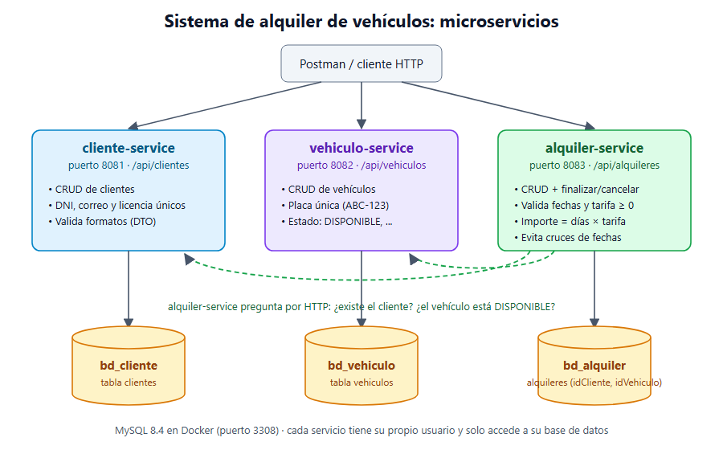

# Evaluación 03: Sistema de alquiler de vehículos (microservicios)

**Estudiante:** Panez Rondinel, Diego Daniel
**Curso:** Desarrollo de Aplicaciones Web · 4 - C24
**Laboratorio:** 12, Gestión de alquiler de vehículos

Una empresa administra clientes, vehículos y alquileres. El sistema se separa en tres microservicios Spring Boot independientes, cada uno con su propio puerto y su propia base de datos MySQL.



## Requisitos

| Herramienta | Versión |
|---|---|
| Java (JDK) | 21 |
| Maven | incluido (`mvnw`) |
| Spring Boot | 4.1.2 (proyectos creados con Spring Initializr) |
| Docker Desktop | para MySQL 8.4 |
| Postman | app o Postman CLI, para las pruebas |

Dependencias de cada servicio: Spring Web, Spring Data JPA, MySQL Driver, Validation y Spring Boot DevTools.

## Microservicios, puertos y bases de datos

| Servicio | Puerto | Base de datos | Usuario de BD | Responsabilidad |
|---|---|---|---|---|
| `cliente-service` | 8081 | `bd_cliente` | `cliente_user` | CRUD de clientes (DNI, correo y licencia únicos) |
| `vehiculo-service` | 8082 | `bd_vehiculo` | `vehiculo_user` | CRUD de vehículos (placa única, estado) |
| `alquiler-service` | 8083 | `bd_alquiler` | `alquiler_user` | Alquileres: validación de fechas y tarifa, importe estimado |

- Cada servicio tiene **su propio usuario de MySQL**, que solo puede entrar a su base de datos. Así se comprueba que no comparten tablas.
- `alquiler-service` guarda solo `idCliente` e `idVehiculo`. Para saber si existen, **le pregunta por HTTP** a los otros dos servicios; no lee sus tablas.

## Estructura de cada servicio

```text
src/main/java/pe/edu/tecsup/<servicio>/
├── model/        Entidades JPA (tablas) y enums de estado
├── dto/          Request (con validaciones) y Response
├── repository/   Interfaces JpaRepository
├── services/     Lógica de negocio (y, en alquiler, los clientes HTTP)
├── controller/   Endpoints REST
└── exception/    Excepciones propias y GlobalExceptionHandler
src/main/resources/
├── application.yml       Común: puerto, nombre, perfil activo
├── application-dev.yml   Desarrollo: MySQL local en Docker
└── application-prod.yml  Producción: todo por variables de entorno
```

## Cómo ejecutarlo

**1. Encender MySQL (Docker).** Con Docker Desktop instalado:

```bash
eva3 on
```

Si no tienes el comando `eva3`, usa `docker compose up -d --wait` dentro de la carpeta `docker/`. Antes copia `docker/.env.example` como `docker/.env` y pon una clave de root. La primera vez se crean las 3 bases de datos y sus usuarios (`docker/init/01_bases_de_datos.sql`). Las tablas las crea Hibernate al arrancar cada servicio.

**2. Levantar los 3 servicios.** En IntelliJ: abre cada carpeta `*-service` y ejecuta su clase `*ServiceApplication` con SDK 21. Desde la terminal, uno por ventana:

```bash
cd cliente-service && ./mvnw spring-boot:run
cd vehiculo-service && ./mvnw spring-boot:run
cd alquiler-service && ./mvnw spring-boot:run
```

Levanta `cliente-service` y `vehiculo-service` antes de registrar alquileres.

**3. Probar.** Importa `postman/Eva3_Alquiler_Vehiculos.postman_collection.json` en Postman y ejecútala completa (*Run collection*). También se puede correr con el Postman CLI:

```bash
postman collection run postman/Eva3_Alquiler_Vehiculos.postman_collection.json
```

**Pruebas unitarias** (cálculo del importe y validaciones, no necesitan BD):

```bash
cd alquiler-service && ./mvnw test
```

## Perfiles dev y prod

Por defecto arranca `dev`. Para producción: `SPRING_PROFILES_ACTIVE=prod`.

| Valor | dev | prod |
|---|---|---|
| Conexión a la BD | `localhost:3308`, usuario de desarrollo | `DB_URL`, `DB_USER`, `DB_PASSWORD` (variables de entorno) |
| `ddl-auto` | `update`: crea y ajusta las tablas | `validate`: no toca las tablas, solo verifica |
| `show-sql` | `true`: muestra el SQL en consola | `false` |
| Nivel de log | `DEBUG` para el proyecto | `WARN` general, `INFO` para el proyecto |
| URLs de otros servicios (alquiler) | `http://localhost:8081` y `:8082` | `CLIENTE_SERVICE_URL`, `VEHICULO_SERVICE_URL` |

Las credenciales de `dev` son solo para el MySQL local en Docker, no son reales. La clave de root está en `docker/.env`, que no se sube al repositorio.

## Endpoints

### cliente-service (8081)

| Método | Ruta | Descripción | Respuesta |
|---|---|---|---|
| GET | `/api/clientes` | Lista los clientes | 200 |
| GET | `/api/clientes/{id}` | Busca por ID | 200 · 404 |
| POST | `/api/clientes` | Registra | 201 · 400 · 409 (DNI/correo/licencia repetidos) |
| PUT | `/api/clientes/{id}` | Actualiza | 200 · 400 · 404 · 409 |
| DELETE | `/api/clientes/{id}` | Elimina | 204 · 404 |

```json
{ "dni": "71234567", "nombres": "Diego", "apellidos": "Panez Rondinel",
  "correo": "diego@correo.com", "telefono": "987654321", "numeroLicencia": "Q12345678" }
```

### vehiculo-service (8082)

| Método | Ruta | Descripción | Respuesta |
|---|---|---|---|
| GET | `/api/vehiculos?estado=DISPONIBLE` | Lista (filtro de estado opcional) | 200 · 400 |
| GET | `/api/vehiculos/{id}` | Busca por ID | 200 · 404 |
| POST | `/api/vehiculos` | Registra | 201 · 400 · 409 (placa repetida) |
| PUT | `/api/vehiculos/{id}` | Actualiza | 200 · 400 · 404 · 409 |
| DELETE | `/api/vehiculos/{id}` | Elimina | 204 · 404 |

```json
{ "placa": "ABC-123", "marca": "Toyota", "modelo": "Yaris", "anio": 2022, "color": "Plata" }
```

Estados: `DISPONIBLE` (por defecto), `MANTENIMIENTO`, `FUERA_DE_SERVICIO`.

### alquiler-service (8083)

| Método | Ruta | Descripción | Respuesta |
|---|---|---|---|
| GET | `/api/alquileres?idCliente=1` | Lista (filtro por cliente opcional) | 200 |
| GET | `/api/alquileres/{id}` | Busca por ID | 200 · 404 |
| POST | `/api/alquileres` | Registra y calcula el importe | 201 · 400 · 404 · 409 · 503 |
| PUT | `/api/alquileres/{id}` | Actualiza (solo si está ACTIVO) y recalcula | 200 · 400 · 404 · 409 |
| PATCH | `/api/alquileres/{id}/estado` | Finaliza o cancela: `{"estado": "FINALIZADO"}` | 200 · 409 |
| DELETE | `/api/alquileres/{id}` | Elimina | 204 · 404 |

```json
{ "idCliente": 1, "idVehiculo": 1, "fechaInicio": "2026-11-10", "fechaFin": "2026-11-13", "tarifaDiaria": 150.00 }
```

Respuesta: `"dias": 3, "importeEstimado": 450.00, "estado": "ACTIVO"`.

## Reglas de negocio del alquiler

- **Validaciones de entrada (400):**
  - todos los campos son obligatorios;
  - la `fechaInicio` no puede ser anterior a hoy;
  - la `fechaFin` debe ser posterior a la `fechaInicio`;
  - la `tarifaDiaria` no puede ser negativa.
- **Importe estimado** = días entre `fechaInicio` y `fechaFin` × `tarifaDiaria` (con `BigDecimal`, redondeado a 2 decimales).
- **Referencias (404):** el cliente y el vehículo deben existir en sus servicios.
- **Disponibilidad (409):**
  - el vehículo debe estar `DISPONIBLE`;
  - no puede tener otro alquiler `ACTIVO` que se cruce con esas fechas.
- **Estados:** un alquiler nace `ACTIVO` y pasa a `FINALIZADO` o `CANCELADO`. Después ya no se modifica (409).
- **Servicio caído (503):** si `cliente-service` o `vehiculo-service` no responden, se informa con un 503 en lugar de un error genérico.

## Manejo de errores

Todos los errores tienen el mismo formato. Ejemplo de un alquiler con fechas invertidas y tarifa negativa:

```json
{
  "fecha": "2026-11-06T12:17:28.10",
  "estado": 400,
  "error": "Bad Request",
  "mensaje": "Los datos enviados no son válidos",
  "ruta": "/api/alquileres",
  "campos": {
    "tarifaDiaria": "La tarifa diaria no puede ser negativa",
    "rangoDeFechasValido": "La fecha de fin debe ser posterior a la fecha de inicio"
  }
}
```

| Código | Cuándo |
|---|---|
| 400 | Falla una validación del DTO, JSON mal formado, fecha imposible o ID que no es número |
| 404 | El ID no existe (en el servicio o en el servicio consultado) |
| 409 | Dato único repetido, vehículo no disponible, fechas cruzadas o alquiler ya cerrado |
| 503 | Otro microservicio no responde |

## Evidencias

- `postman/`: colección con 34 solicitudes (casos exitosos y de error) y 66 comprobaciones automáticas. Resultado: 0 fallos.
- `sql/bd_alquiler_vehiculos.sql`: esquema y datos de las 3 bases de datos.
- `docker/init/01_bases_de_datos.sql`: creación de las bases de datos y sus usuarios.
- `diagrama_microservicios.png` / `.svg`: diagrama de servicios y bases de datos.
